# Loan Clarity — Bank of America Case-A-Thon (Option A)

**Faster, clearer answers on loans for mid-market businesses.**

> **Live demo:** _add the Vercel URL here_ · **Code:** https://github.com/musarahman06/Bank-of-America-Case-A-Thon

Loan Clarity is an AI-powered lending assistant. A business enters its financials and gets **three scored loan offers in under a second**, each with a plain-English explanation of what it can borrow and what's holding it back. Clients can also bring the loan they want and get an instant verdict with better alternatives. The same engine powers a **Banker view** for relationship managers, adding the internal underwriting detail behind every answer.

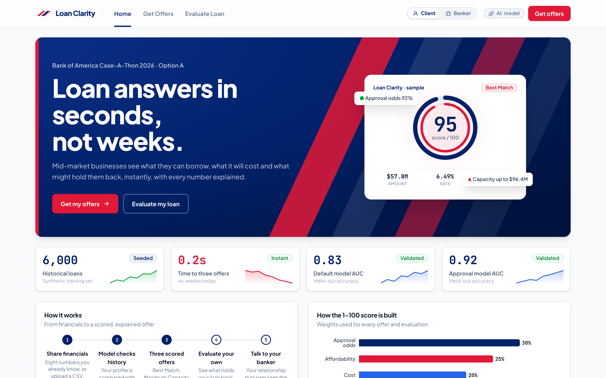

---

## See it in action

| Get Loan Offers: live preview | Three scored offers |
|---|---|
| 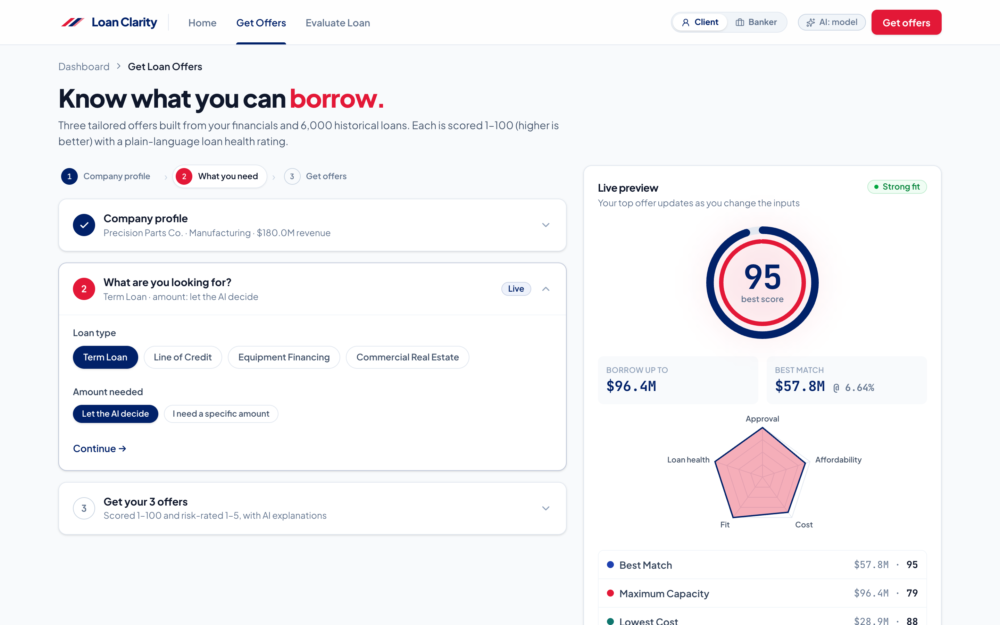 | 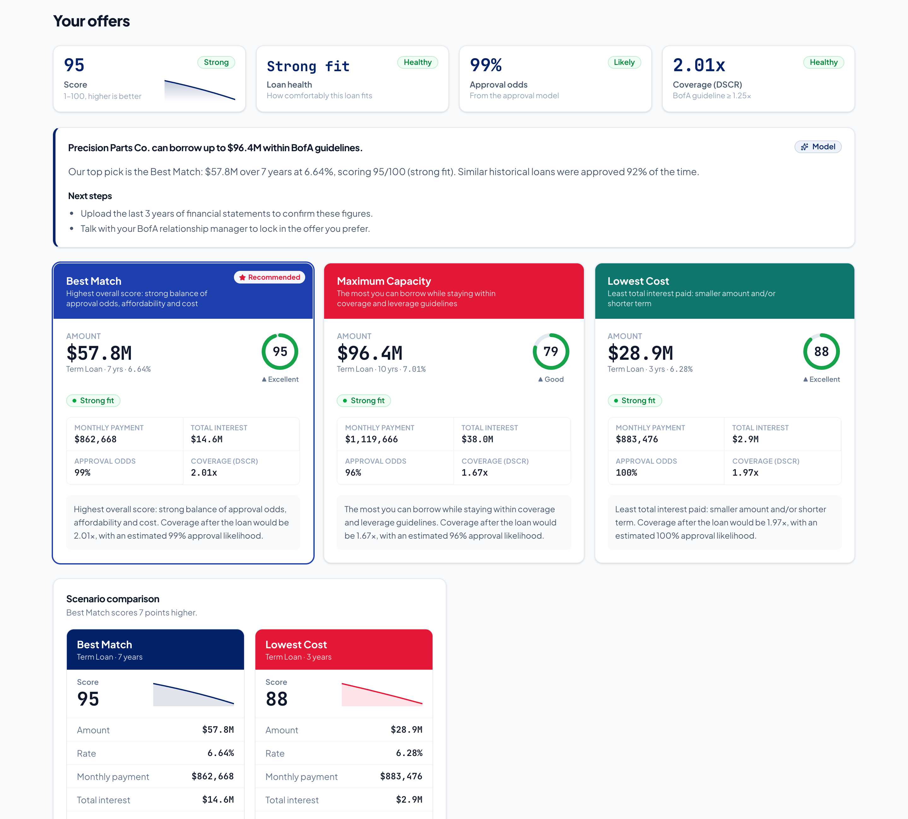 |
| **Evaluate My Loan: live scorecard** ($30M request → 22/100, "Hard to approve") | **Full analysis: what's holding it back + comparison** |
| 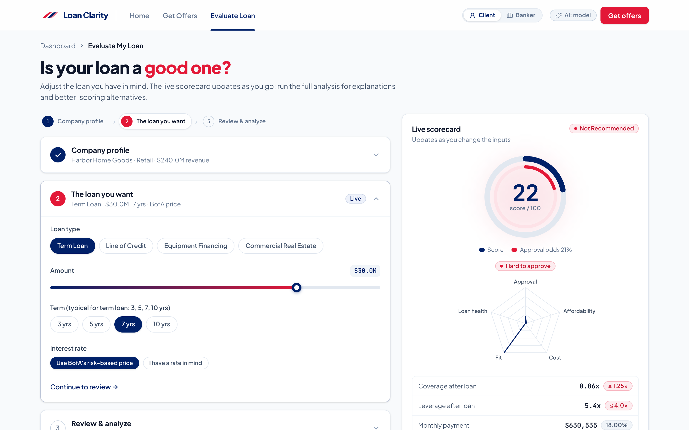 | 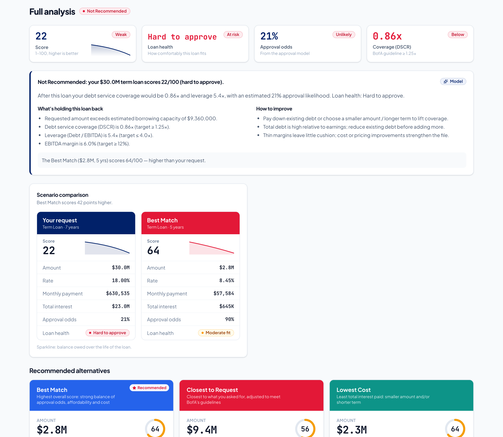 |
| **Banker view: Credit view + risk heat matrix** | **Banker view: where the money comes from** |
| 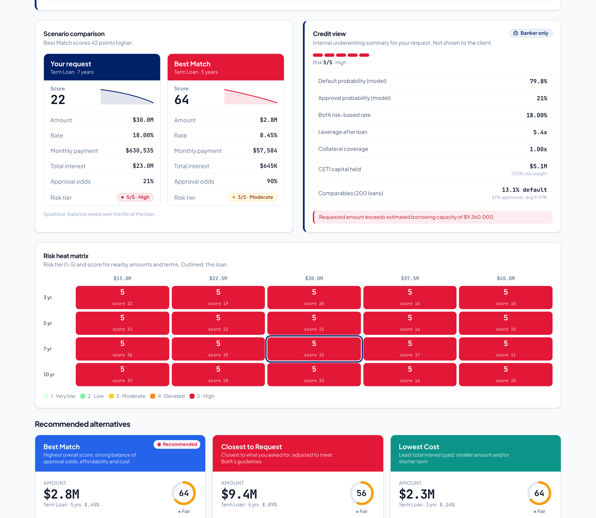 | 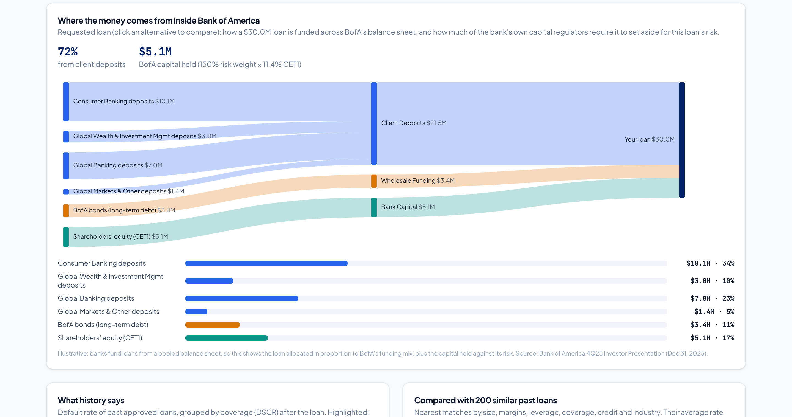 |

<details>
<summary>More screenshots (landing dashboard, alternatives, mobile)</summary>

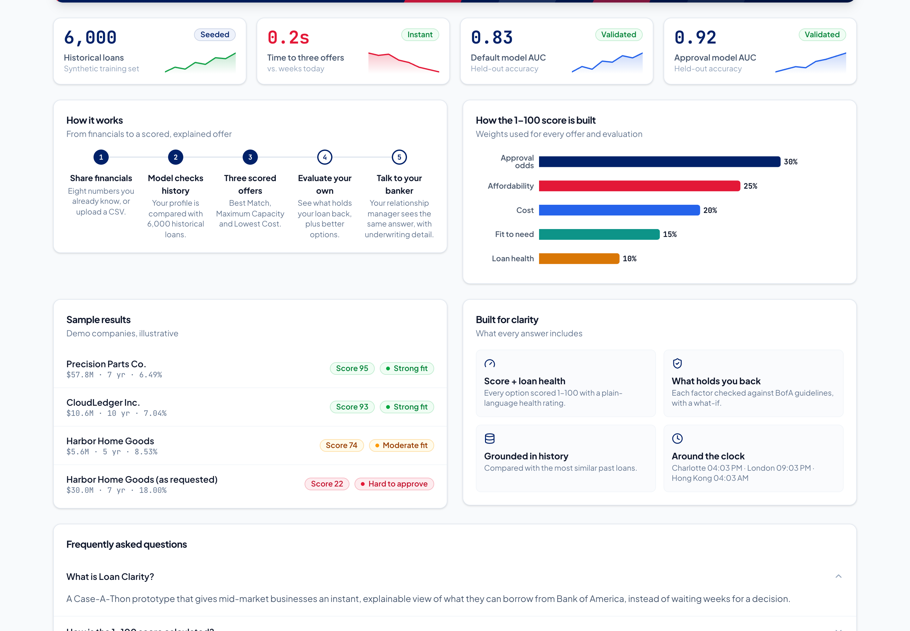
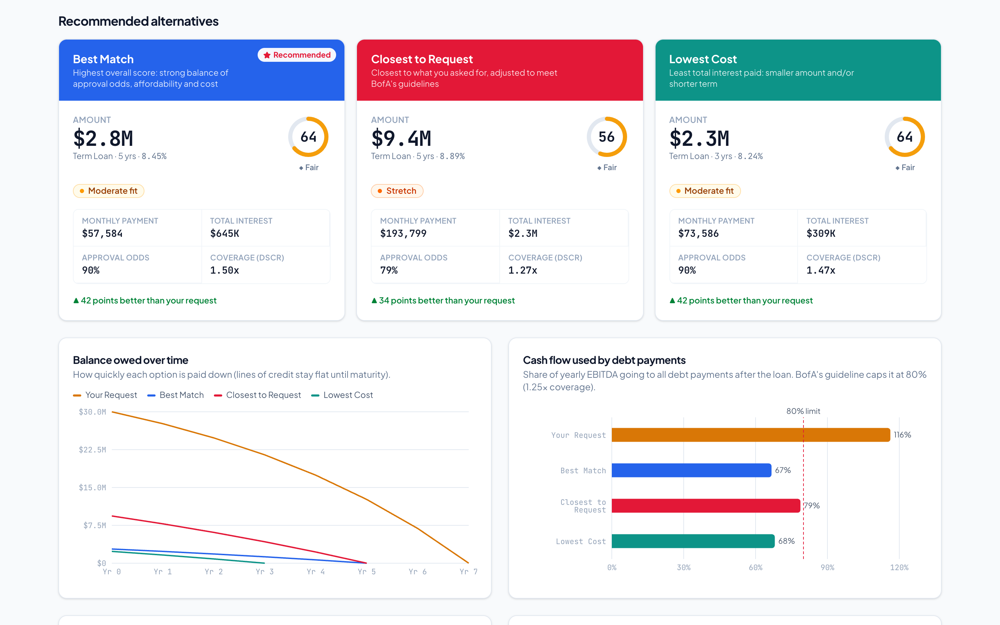

<p>
  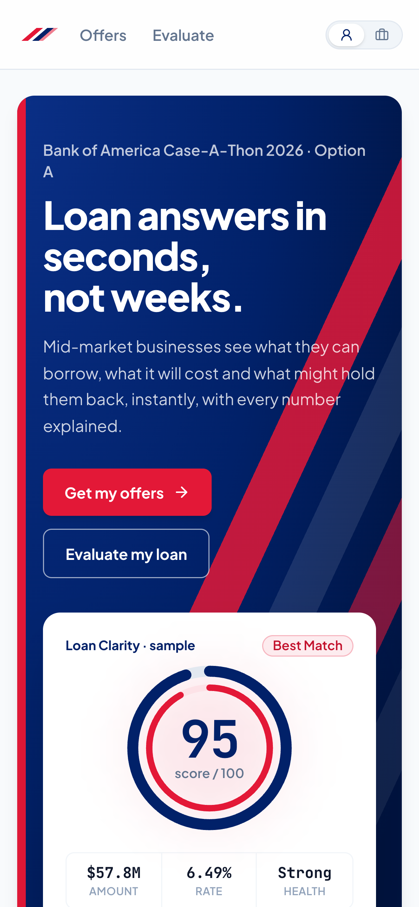
  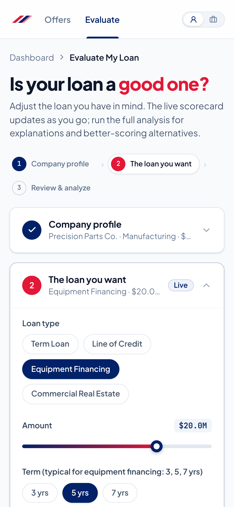
</p>
</details>

---

## Part 1 — The case

### The client problem (Option A)

Mid-market businesses applying for a loan can wait **weeks** for a decision. They often don't know:
- how much they could borrow,
- what it would cost, or
- what might hold them back.

That uncertainty slows growth plans and pushes clients toward faster, less transparent lenders.

### Our solution

| | What the client gets |
|---|---|
| **Get Loan Offers** | Enter eight familiar numbers (revenue, margins, debt, collateral, credit…) or upload a CSV. Get **3 tailored offers**: *Best Match*, *Maximum Capacity* and *Lowest Cost*. Each is **scored 1–100** (higher is better for the client) with a plain-language **loan health** rating. |
| **Evaluate My Loan** | Already know what you want? Adjust amount, term and rate with sliders. A **live scorecard** re-scores instantly, then the full analysis gives a verdict (*Good / Caution / Not Recommended*), what's holding it back, how to improve, and **3 better-scoring alternatives**. |
| **Explained, not just scored** | Every factor (coverage, leverage, credit, margins, collateral, liquidity, growth) is checked against lending guidelines. A model **what-if** shows how many points the score would gain if each factor improved. |
| **Banker view** | One switch reveals the internal view for relationship managers: **risk tier 1–5**, default probability, comparable past loans, a **risk heat matrix**, and **how BofA would fund the loan** and the capital it must hold. |

### Why this is good for Bank of America

1. **Speed wins deals.** Weeks of back-and-forth become a credible indicative answer in seconds. Mid-market clients get certainty while their decision is still being made, before they shop elsewhere.
2. **Transparency builds trust and deepens relationships.** Clients see *why* (coverage, leverage, margins) and *how to improve*, not just yes/no. A client who understands their path to a better offer stays and comes back. Commercial relationships also bring operating deposits: BofA's Global Banking segment averaged **$656B in deposits in 4Q25, up 13% year over year** (BofA 4Q25 investor presentation).
3. **Relationship-manager productivity.** Bankers start each conversation from a pre-scored, explained file: three priced structures, the client's weak spots and comparable outcomes. That's time redirected from spreadsheets to advice.
4. **Risk discipline built in.** Offers respect coverage (DSCR ≥ 1.25x) and leverage (Debt/EBITDA ≤ 4.0x) guidelines. Pricing is risk-based, and requests priced below the bank's risk-based rate are flagged automatically.
5. **Capital-aware lending.** The Banker view connects each loan to the bank's balance sheet: deposits, wholesale funding, and the CET1 capital it ties up (more for riskier loans). Growth and capital efficiency stay in the same conversation.
6. **Responsible, explainable AI.** The ML models are **monotonic-constrained**: better coverage can never *raise* predicted risk. Every number comes from the models; the generative AI (Gemini) only explains them and is instructed never to invent figures. Client-facing text never exposes internal risk tiers, default probabilities or funding data.
7. **One engine, two audiences.** The same scoring powers a client self-service portal and an internal banker workbench. It's a natural fit for a digital commercial-banking platform such as CashPro.

### Demo script (3 minutes)

1. **Home → Get Offers.** Load *Precision Parts Co.*: healthy manufacturer, scores **95 / 79 / 88**, "Strong fit", borrowing capacity ~$96M.
2. Load *Harbor Home Goods* (leveraged retailer): scores drop to **74 / 56 / 69**. The "What's holding you back" table names thin margins and high leverage, with the points each fix would add.
3. **Evaluate Loan** with Harbor's **$30M** request. The live scorecard shows **22/100, "Not Recommended", "Hard to approve"**. Drag the amount slider down and watch the score recover in real time. Run the full analysis: alternatives score **~40 points higher**.
4. Flip the navbar switch to **Banker**: the same file now shows risk tier **5/5**, default probability, comparables, the heat matrix, the Credit view card and the **funding Sankey**. Click another offer and riskier loans tie up more BofA capital.
5. Flip back to **Client**: the borrower sees loan health and guidance, and none of the bank's internal figures.

### Honest limitations and next steps

- **The data is synthetic.** BofA's loan history isn't public, so the models train on a seeded, realistic stand-in. Next step: retrain on BofA's real mid-market loan book, with fairness and model-risk review.
- **The offers are indicative, not credit decisions.** A relationship manager and full underwriting confirm any offer.
- **The Banker view switch is for the demo only.** Production would gate it behind BofA sign-in and strip internal fields server-side.
- **The funding allocation is illustrative.** Banks fund from a pooled balance sheet, so the loan is allocated in proportion to the 4Q25 funding mix.
- **Roadmap:** document upload (financial statements → auto-filled profile), covenant suggestions, an RM hand-off workflow, and monitoring for model drift.

---

## Part 2 — How it works (technical)

### Architecture

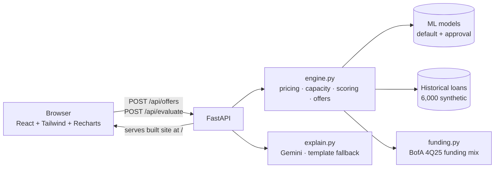

It's **one deployable app**: FastAPI serves the JSON API under `/api` *and* the built React site at `/`.

### Repository layout

```
backend/
  data/generate_data.py   seeded synthetic loan history  -> data/loans.csv (generated)
  ml/train.py             trains + evaluates models      -> ml/artifacts/*.joblib (generated)
  app/features.py         shared loan math + model features
  app/engine.py           pricing, capacity, scoring, offers, factors, comparables, risk matrix
  app/funding.py          BofA funding-source breakdown per loan
  app/explain.py          Gemini explanations (client-safe) + template fallback
  app/schemas.py          Pydantic request models
  app/main.py             FastAPI routes + serves frontend/dist
frontend/
  src/pages/              Landing, OfferMode (#/offers), ReverseMode (#/evaluate)
  src/ui/                 Card, Slider, PillGroup, StepCard, Dropzone, Badge, Stat, RadialGauge
  src/components/         OfferCard, KpiRow, ScenarioCompare, RiskHeatMatrix, CreditView, FactorsTable…
  src/charts/             Recharts charts, ScoreRadar, FundingSankey
  src/hooks/useView.tsx   Client / Banker view context
build.py                  data -> models -> frontend bundle (used locally and by Vercel)
pyproject.toml            Python deps + Vercel entrypoint
vercel.json               function config
design-refs/              UI reference designs
```

### 1. Data (`backend/data/generate_data.py`)
- **6,000 historical mid-market loans** across 10 industries: revenue $10M–$1B, EBITDA margin, growth, current ratio, credit score, existing debt, collateral, plus loan type, amount, term and the rate charged.
- Outcomes (**approved**, **defaulted**) are drawn from logistic functions of real credit drivers: post-loan coverage (DSCR), leverage, margins, growth, credit, collateral, operating history and industry risk. That's why the models learn realistic relationships.
- Seeded (`seed=42`), so every build and every demo produces the same numbers.

### 2. Machine learning (`backend/ml/train.py`)

| Model | Trained on | Predicts | Held-out AUC |
|---|---|---|---|
| Default model | approved loans | P(default) | ≈ 0.83 |
| Approval model | all applications | P(approval) | ≈ 0.92 |

- Both are scikit-learn `HistGradientBoostingClassifier` models with **monotonic constraints**. For example, higher DSCR or credit score can only lower default risk, which keeps outputs explainable and defensible.
- **Features:** industry risk, years in business, log revenue, EBITDA margin, revenue growth, current ratio, credit score, post-loan DSCR, post-loan leverage, collateral coverage, loan-to-revenue, term and loan type.
- Models are trained at build time, so the artifacts are never committed.

### 3. Decision engine (`backend/app/engine.py`)
- **Risk-based pricing:** rate = base + spread from predicted default + term premium + product adjustment. It's solved iteratively, since the rate affects DSCR, which affects risk.
- **Borrowing capacity:** the largest amount, per term, that keeps **DSCR ≥ 1.25x** and **Debt/EBITDA ≤ 4.0x**.
- **Offer search:** scores a grid of amount × term candidates in one vectorized model call, then picks *Best Match* (highest score), *Maximum Capacity* (largest healthy amount) and *Lowest Cost* (least total interest). In reverse mode the second pick becomes *Closest to Request*.
- **Score 1–100:** 30% approval odds + 25% affordability (post-loan DSCR) + 20% cost (APR) + 15% fit to the amount needed + 10% loan health.
- **Risk tier 1–5:** P(default) buckets <2%, 2–5%, 5–10%, 10–20%, >20%. Clients see it as *Strong fit / Moderate fit / Stretch / Hard to approve*.
- **Factors and what-ifs:** rule checks against guidelines. The engine re-scores with each factor at its target to report "+N points if fixed".
- **Comparables:** the nearest 200 historical loans in standardized feature space give their approval rate, default rate and average rate.
- **Risk matrix:** risk and score across 50–150% of the amount × the product's terms.
- **Speed:** about 0.2s per request.

### 4. Funding view (`backend/app/funding.py`)
- **Source data:** BofA's funding mix from the **4Q25 investor presentation** (Dec 31, 2025):
  - average deposits by segment: Consumer $945B, GWIM $280B, Global Banking $656B, plus other
  - long-term debt: $318B
  - common equity: $277B
  - CET1 ratio: 11.4%
- **Capital held** = loan amount × risk weight (higher for riskier tiers) × CET1 ratio. The rest of the loan is allocated across deposits and long-term debt in proportion to the balance sheet.

### 5. Generative AI (`backend/app/explain.py`)
- Google **Gemini** (`google-genai`, model set by `GEMINI_MODEL`) turns the engine's numbers into a headline, reasons, "what's holding you back" and next steps, returned as JSON.
- **Guardrails:**
  - Gemini receives only client-safe fields: no default probability, no risk tier, no funding data.
  - The system prompt forbids inventing figures.
  - If there's no key or the call fails, deterministic template text is returned, so the demo never breaks.

### 6. API

| Method | Path | Body | Returns |
|---|---|---|---|
| `GET` | `/api/meta` | — | industries, loan types/terms, demo presets, model metrics, whether AI is enabled |
| `POST` | `/api/offers` | `company`, `loan_type`, `desired_amount?`, `explain?` | capacity, 3 offers (score, risk, rate, payment, schedule, funding), factors, comparables, history curve, risk matrix, `ai` |
| `POST` | `/api/evaluate` | `company`, `loan_type`, `amount`, `term_years`, `rate_pct?`, `explain?` | requested loan + verdict, flags, 3 alternatives, factors, comparables, risk matrix, `ai` |

`explain: false` skips Gemini and returns numbers only. The live scorecards use it to re-score on every slider move (debounced ~350ms).

```bash
curl -X POST http://localhost:8000/api/evaluate -H 'content-type: application/json' -d '{
  "company": {"name":"Harbor Home Goods","industry":"Retail","years_in_business":14,
              "annual_revenue":240000000,"ebitda_margin":0.06,"revenue_growth":-0.04,
              "current_ratio":1.05,"credit_score":664,"existing_debt":48000000,"collateral_value":30000000},
  "loan_type":"Term Loan","amount":30000000,"term_years":7,"explain":false }'
```

### 7. Frontend (`frontend/`)
- **Stack:** React 19 + TypeScript + Vite, **Tailwind v4**, Recharts and lucide icons. The theme is BofA navy `#012169` and crimson `#E31837` on a slate canvas, with JetBrains Mono tabular numbers.
- **Routes** (hash-based): `#/` landing (bento dashboard), `#/offers`, `#/evaluate`.
- **Layout:** a 7/5 split. On the left, numbered step cards with custom sliders, pill selectors and a CSV/JSON dropzone (parsed in the browser only). On the right, a sticky live scorecard with a radial gauge and a radar of the five score components.
- **Results:** a KPI row, offer cards, scenario comparison, charts (balance paydown, cash flow to debt, score breakdown, capacity by term) and the factors table.
- **Banker view only:** the Credit view card, risk heat matrix, history and comparables charts, and the funding Sankey.
- **Client / Banker:** a React context (`useView`) remembered in localStorage. It decides which components render. AI text is always client-safe, so switching views never needs a new AI call.

---

## Run it locally

```bash
python3 -m venv .venv && .venv/bin/pip install -e .
cp backend/.env.example backend/.env    # optional: add GEMINI_API_KEY for AI explanations
.venv/bin/python build.py               # data -> models -> frontend bundle
.venv/bin/uvicorn backend.app.main:app  # http://localhost:8000
```

For UI hot reload, also run `npm run dev` in `frontend/` and open http://localhost:5173. It proxies `/api` to :8000.

## Deploy on Vercel (one project)

Every deploy runs `build.py`: it generates the data, trains and scores the models, then builds the React app. Here's a real run:

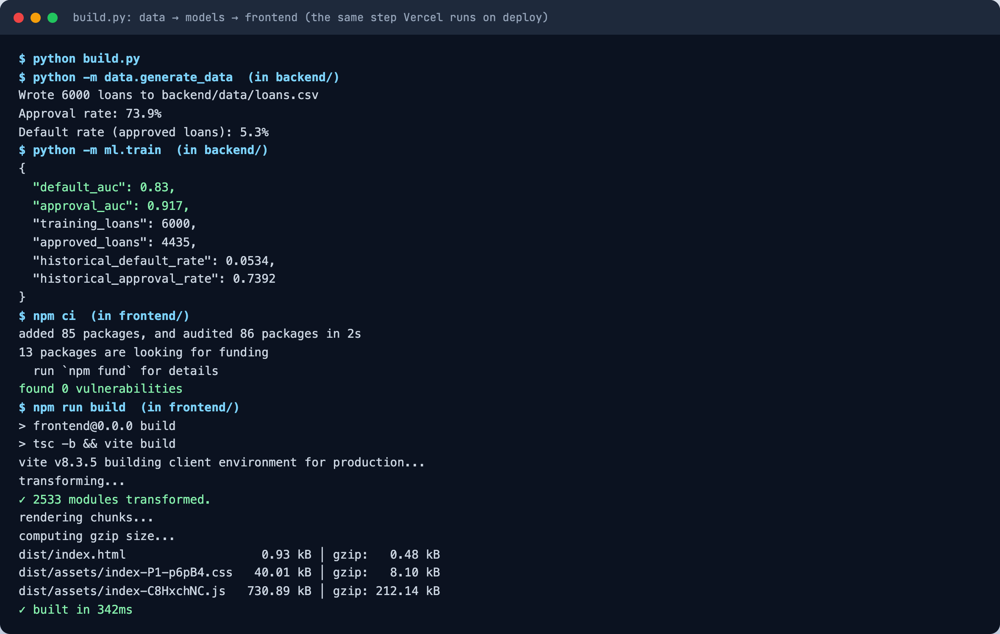

1. Import the GitHub repo on vercel.com (**Add New → Project**). Keep **Root Directory** at the repo root and set the preset to **FastAPI** if it isn't detected. `pyproject.toml` provides the entrypoint and the `build.py` build step.
2. Under **Environment Variables**, add `GEMINI_API_KEY` (optional `GEMINI_MODEL=gemini-3.8-flash`), then **Deploy**.
3. Every push to `main` redeploys automatically.

---

*Case-competition prototype. Training data is synthetic; funding figures are illustrative, from Bank of America's 4Q25 investor presentation. Not a credit decision.*
